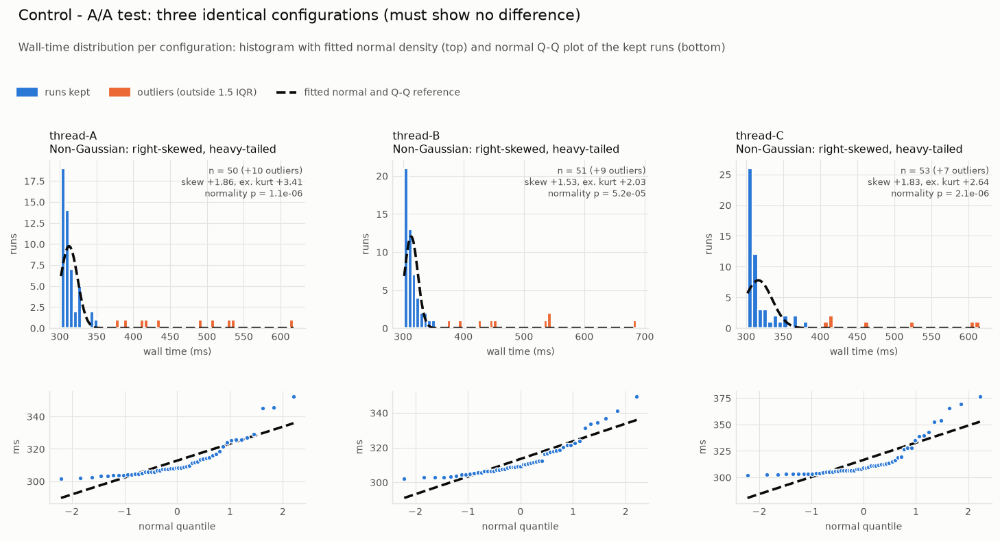
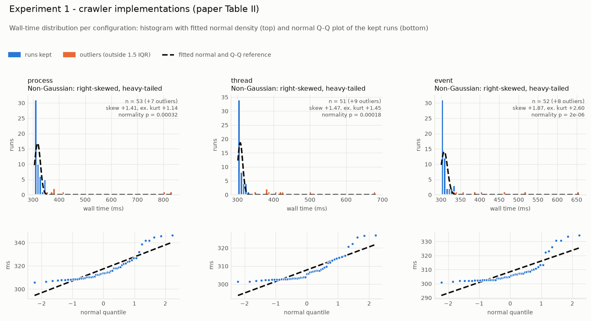
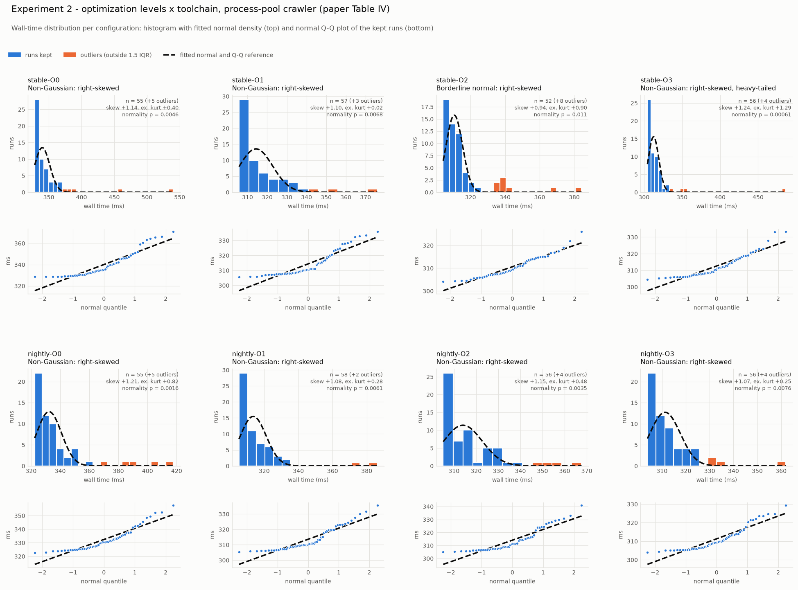
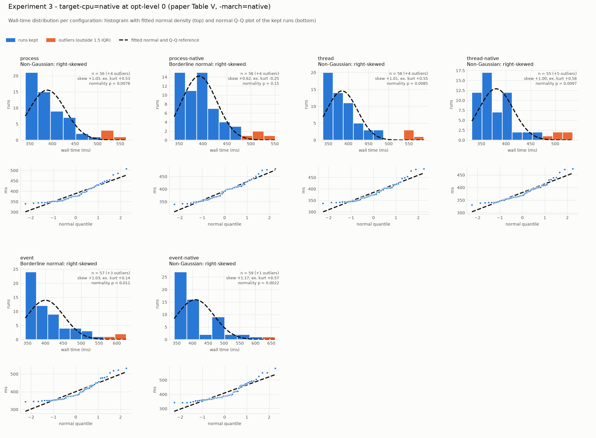

# io-bound-perf-testing

This repository is a Rust reimplementation of the test bench from Sultanov et al., "A
statistics-based performance testing methodology: a case study for the I/O bound tasks" (IEEE
CSIT 2022), plus a set of checks on whether the paper's statistical method actually works.

> A. Sultanov, M. Protsyk, M. Kuzyshyn, D. Omelkina, V. Shevchuk, O. Farenyuk,
> "A statistics-based performance testing methodology: a case study for the I/O bound tasks",
> 2022 IEEE 17th International Conference on Computer Sciences and Information Technologies (CSIT),
> DOI [10.1109/CSIT56902.2022.10000626](https://doi.org/10.1109/CSIT56902.2022.10000626).
> Original C++ code: <https://github.com/dariaomelkina/parallel-crawling-research>

The original work is in C++. Here, the three crawlers, the HTTP server, the dataset generator and
the benchmark harness are rewritten, and the analysis pipeline from Section III of the paper is
implemented in Python. On top of that there are unit tests, a Monte Carlo study with known ground
truth, an A/A control run on real hardware, and a consistency check of the tables published in the
paper.

## Summary of results

Most of the method holds up. A few points are worth knowing before you use it:

- Randomizing the execution order matters more than any other step. In simulation, a machine that
  slows down by 3% over a session makes two identical programs look 1.5% apart in every single
  experiment when they are measured one after the other. With randomized, interleaved rounds the
  false-positive rate drops to 0.5%. All of the real experiments below showed this kind of drift.
- The Bonferroni correction is needed. Without it, about 30% of experiments with five identical
  configurations report a difference that is not there.
- The method does detect effects smaller than the run-to-run noise, and the A/A control on real
  hardware produced no false differences.
- The outlier step, as written in the paper, is flawed. Computing the IQR fences separately for
  each configuration inflates the false-positive rate to as much as 3.3 times the nominal level on
  latency-like data. This project computes one set of fences per compared pair instead, which
  brings the rate back to 5%.
- The claim that 0.1% differences can be detected needs a very quiet machine. At 1% noise you need
  about 2,700 runs per configuration.
- The tables in the paper were computed with a different formula from the one in the caption: they
  divide by `max(t_row, t_col)`, not `min`. This changes the meaning of the percentages, not the
  conclusions.
- On an Apple M3, the process pool is about 1.3% slower than the thread pool and the event loop,
  opt-level 0 costs 6–8% while levels 1–3 are indistinguishable, and `target-cpu=native` has no
  measurable effect.

## Background: what the paper proposes

Performance measurements are noisy. Caches, scheduling, frequency scaling and the network all vary
between runs, so a single run, or the average of a few, cannot tell you whether variant A is really
faster than variant B. The paper applies the standard statistical treatment used in experimental
sciences:

| Step | What | Why |
|---|---|---|
| 1 | Randomize the input (shuffle the URL list) and the execution order | Uncontrolled factors such as heat or background jobs affect every variant equally instead of biasing one ([Mytkowicz et al. 2009](https://doi.org/10.1145/1508284.1508275)) |
| 2 | Run many repetitions | Gives a sample of each variant's execution-time distribution |
| 3a | Remove outliers outside `[Q1 − 1.5·IQR, Q3 + 1.5·IQR]` | Rare spikes distort the mean and inflate the variance |
| 3b | D'Agostino–Pearson normality test (skewness and kurtosis) | Decides which hypothesis test is valid |
| 4 | Bonferroni correction: `α_c = α / m` for `m` comparisons | With many comparisons, some look significant by chance |
| 6 | If both samples are normal, two-sided Student t-test on the means | The most powerful test when its assumptions hold |
| 7 | Otherwise, Wilcoxon rank-sum (Mann–Whitney U) test on the minimums | Valid for any distribution; for latency, the minimum is the least noisy estimate of the true cost |
| 8 | Run the rank-sum test as a double check even for normal data | Robustness |

Effects are reported as `rel = (t_row − t_col) / min(t_row, t_col) · 100`, where a positive value
means the column variant is faster. A pair counts as different only if `p < α_c`.

The case study is a set of web crawlers, chosen because crawling is I/O-bound: a process pool
(one fork per worker, blocking sockets), a thread pool (blocking sockets) and an M:N event loop on
epoll. They download 130,000 HTML pages from NGINX running on a second machine, and the paper varies
the compiler (GCC or Clang), the optimization level, `-march=native`, Turbo Boost and
Hyper-threading. The headline claim is that, with enough runs, the method reliably detects effects
as small as 0.1%, which is below the run-to-run noise.

## Quick start

You need a Rust toolchain (`rustup`), the `nightly` toolchain for the toolchain experiment, and
Python 3.10 or later.

[RUNNING.md](RUNNING.md) has a full walkthrough, including a short demo, the options of each
script, how to read the reports and a troubleshooting table.

```bash
cd io-bound-perf-testing
python3 -m venv .venv && .venv/bin/pip install -r requirements.txt   # Installs numpy, scipy and matplotlib.
.venv/bin/python dataset/generate.py                                  # Writes data/pages and data/urls.txt.

# macOS only: required if `cargo build` reports an Xcode license error.
export DEVELOPER_DIR=/Library/Developer/CommandLineTools

cargo build --release && cargo test --release                       # Builds the crawlers and server; runs the Rust unit tests.

# Each experiment builds the variants, starts the server, runs a correctness check,
# and then performs randomized runs.
.venv/bin/python bench/run_experiment.py experiments/crawlers.json
.venv/bin/python analysis/pipeline.py results/crawlers               # Writes report.md and analysis.json.
.venv/bin/python analysis/plots.py results/crawlers                  # Writes distributions.png and distributions.md.

# Verification
.venv/bin/python -m unittest discover -s verification -v             # Pipeline unit tests.
.venv/bin/python verification/check_paper_tables.py                  # Consistency check of the paper's tables.
.venv/bin/python verification/simulate.py --trials 1000              # Monte Carlo simulation (about 1 minute).

./run_all.sh                                                         # Runs all of the above for every experiment.
```

To run a single crawler by hand:

```bash
./target/release/static_server --root data/pages --port 8080 --delay-us 1000 &
./target/release/crawler --mode event --urls data/urls.txt --port 8080 --seed 42 --threads 2 --conns 8
# Example output: {"crawler":"event-kqueue","build":"dev","seed":42,"urls":4000,"wall_ns":327904125,"pages":4000,...}
```

## Project layout

```
Cargo.toml, rust-toolchain.toml
src/
  lib.rs                 crate documentation
  common.rs              shared crawler code: URL loading, seeded shuffle, slicing, simulated tag parser
  http.rs                HTTP/1.1 request builder, incremental response parser, blocking keep-alive client
  crawlers.rs            ProcessPool (fork), ThreadPool (std::thread), EventLoop (mio: epoll or kqueue)
  bin/crawler.rs         one measured run, printed as one JSON line
  bin/static_server.rs   in-memory keep-alive HTTP server, used in place of NGINX
dataset/generate.py      deterministic synthetic HTML corpus with log-normal page sizes
bench/build.py           builds variants (toolchain, opt-level, RUSTFLAGS) into build/<variant>/crawler
bench/run_experiment.py  correctness check, then randomized interleaved runs into results/<exp>/runs.csv
analysis/pipeline.py     the statistical pipeline, usable as a library or a CLI
analysis/plots.py        distribution plots and shape classification
verification/
  test_pipeline.py       unit tests of each step against inputs with a known answer
  check_paper_tables.py  consistency check of Tables II-V in the paper
  simulate.py            Monte Carlo study: error rates, power, randomization, outliers
experiments/*.json       experiment definitions (variants, configurations, comparison groups)
results/                 generated output for each experiment, plus results/verification/
run_all.sh               reproduces everything
```

## How the test bench works

### Crawlers

All crawlers receive the same shuffled URL list and split it into contiguous slices, one per
worker. As in the paper, the workers never talk to each other, so the concurrency model is the only
thing that differs between the crawlers (`src/crawlers.rs`).

| Mode | Paper | This project |
|---|---|---|
| `process` | process pool | `fork()` per worker; each child uses a blocking keep-alive `TcpStream` and sends its `CrawlStats` back through a pipe |
| `thread` | thread pool | `std::thread::scope` per worker, blocking keep-alive `TcpStream` |
| `event` | M:N with epoll | M threads, each driving N non-blocking connections through a `mio` readiness loop. `mio` uses epoll on Linux, as in the paper, and kqueue on macOS. Each connection is a small state machine: `Connecting → Sending → Receiving → (next URL) Sending …` |

Each crawler "parses" every page by counting its tags into a hash map, which is what the paper
does too. All three must report identical `pages`, `bytes` and `tags`, and the harness checks this
before it starts measuring, so a crawler that silently skipped work would be caught. If the server
closes a connection (`Connection: close`, or NGINX's `keepalive_requests` limit), the crawler
reconnects and retries the request. The server's `--max-requests` flag exists to test that path.

`wall_ns` is measured with a monotonic clock (`Instant`) around `crawler.run()` only. Process
start-up, reading the URL file and shuffling are not included. Forking the workers is included,
since that is part of what the process-pool design costs.

### Server

The paper serves files from a RAM disk with NGINX on a second machine, over a direct Gigabit
Ethernet link, without TLS or compression. The bundled server (`src/bin/static_server.rs`) loads
every file into memory, speaks keep-alive HTTP/1.1 with `TCP_NODELAY`, and uses one thread per
connection. `--delay-us` adds a fixed service delay (1 ms by default) so that the workload stays
I/O-bound over loopback. The harness can also be pointed at a real NGINX server; see "Running on
Linux or over a real network" below.

### Dataset

The paper's 130,000-page dataset is only available through a link shortener, so
`dataset/generate.py` builds a deterministic replacement: log-normal page sizes with a median of
8 KiB, and a mix of common tags, comments and links. The default is 4,000 pages (about 44 MiB).
`--pages 130000` matches the paper's page count, and `--index-only` indexes a real corpus that you
have extracted into `data/pages`.

### Harness

An experiment file in `experiments/` defines:

- variants, which are the compile-time factors. The `stable` and `nightly` toolchains stand in for
  GCC and Clang, `opt_level` 0–3 corresponds to `-O0` to `-O3`, and
  `rustflags: "-C target-cpu=native"` corresponds to `-march=native`;
- configurations, each of which is a variant plus a crawler mode and its arguments, optionally with
  a `pre_cmd` such as a command that toggles Turbo Boost;
- comparison groups. Every pair within a group is tested, and the total number of pairs is the
  Bonferroni `m`.

`bench/run_experiment.py` then:

1. builds each variant with its own `CARGO_TARGET_DIR`, opt-level and `RUSTFLAGS`, and copies the
   binary to `build/<variant>/crawler`;
2. starts the server and runs every configuration once as a correctness check (identical work, zero
   errors);
3. runs `warmup` rounds that are thrown away, then `reps` measured rounds. Each round runs every
   configuration once in a newly shuffled order, and each run gets its own random seed for the URL
   order. The master seed and every per-run seed are recorded, so any run can be replayed;
4. writes `runs.csv` (one row per run) and `meta.json` (machine, OS, toolchain versions, seeds and
   the full configuration).

## The statistical pipeline

`analysis/pipeline.py` implements Section III of the paper. It can be imported
(`analyze(samples, pairs, ...)`) or run from the command line:

```
.venv/bin/python analysis/pipeline.py results/<exp> [--alpha 0.05] [--m N] [--alpha-normal 0.01]
        [--outliers pooled|per-group|none] [--denominator min|max|row] [--welch] [--suffix _x]
```

| Step | Implementation |
|---|---|
| Outliers | Tukey fences at `1.5·IQR`. The default, `pooled`, computes the fences from the two samples being compared; `per-group` uses per-configuration fences as in the paper. The reason for the different default is explained in the verification section (E). |
| Normality | `scipy.stats.normaltest` (D'Agostino–Pearson K²) at `α_normal = 0.01`. "Normal" means that normality was not rejected. Samples with n < 20 are treated as non-normal, because the kurtosis test is not valid below 20. |
| Bonferroni | `α_c = α / m`, where `m` defaults to the number of pairs in the experiment's comparison groups. |
| Both normal | `scipy.stats.ttest_ind` (Student, or Welch with `--welch`); the effect is computed from the means. |
| Otherwise | `scipy.stats.mannwhitneyu` (two-sided), which is the Wilcoxon rank-sum test; the effect is computed from the minimums. |
| Double check | The rank-sum p-value is always reported, and any disagreement with the t-test is flagged. |
| Drift diagnostic | Spearman ρ between run order and wall time for each configuration. A significant ρ means the machine drifted during the experiment. Randomized rounds keep that drift from turning into bias. |

## Does the method hold up?

The verification has five parts, and `./run_all.sh` regenerates all of them.

| Check | What it tests | Where |
|---|---|---|
| Rust unit tests | Tag parser, deterministic shuffle, range splitting, HTTP parser (split and pipelined responses, `Connection: close`, rejection of chunked responses) | `cargo test` (5 tests) |
| Pipeline unit tests | Each statistical step against inputs with a known answer: IQR fences, normality decisions, Bonferroni, the relative-difference formula, test selection, and an end-to-end A/A case against a real 2% shift | `verification/test_pipeline.py` (12 tests) |
| Paper consistency | Whether the published tables can be recomputed from their own formula, and whether the quoted p-values are significant under the stated Bonferroni factors | `verification/check_paper_tables.py`, output in `results/verification/paper_tables.md` |
| Monte Carlo | Error rates and power of the whole pipeline on synthetic data where the truth is known | `verification/simulate.py --trials 1000`, output in `results/verification/simulation.md` |
| A/A control | Three identical configurations, measured with the full harness, must come out as "No diff." | `experiments/aa_test.json`, output in `results/aa_test/report.md` |

The functional checks pass as well. In every experiment, every configuration downloaded exactly
the same pages, bytes and tags with zero errors. With a server that closes keep-alive connections
every 7 requests, all three crawlers still finished without errors.

### A. Multiple comparisons

Five identical configurations give 10 pairwise tests. Each cell below is the fraction of 1,000
simulated experiments that reported at least one false difference. The target is 0.05.

| distribution | no correction | Bonferroni, per-configuration fences (paper) | Bonferroni, pooled fences (default) |
|---|---|---|---|
| normal | 0.285 | 0.084 | 0.042 |
| lognormal | 0.304 | 0.084 | 0.047 |
| shifted-exponential | 0.321 | 0.237 | 0.037 |

Without a correction, roughly 30% of experiments find a difference that does not exist. Bonferroni
brings this down to about 5%, but only if the outlier step is done correctly (see E).

### B. Sensitivity

Two configurations, 1% noise (coefficient of variation), Bonferroni with m = 10. Each cell is the
fraction of experiments that detected the difference with the correct sign.

| true difference | n = 20 | n = 40 | n = 100 |
|---|---|---|---|
| 0.1% | 0.01 | 0.01 | 0.01 |
| 0.25% | 0.02 | 0.04 | 0.14 |
| 0.5% | 0.10 | 0.24 | 0.74 |
| 1% | 0.51 | 0.93 | 0.99 |
| 2% | 1.00 | 1.00 | 1.00 |

The method does find effects smaller than the noise: a difference of half the noise standard
deviation is detected 74% of the time with 100 runs.

The 0.1% claim is a different matter. It depends almost entirely on how quiet the machine is. A
rough power calculation for α_c = 0.005 and 80% power gives `n ≈ 2·(z₀.₉₉₇₅ + z₀.₈)²·(σ/δ)²`, which at
1% noise works out to about 2,700 runs per configuration for a 0.1% effect. The paper's p = 2·10⁻⁵
for a 0.1% effect therefore suggests a very quiet two-machine setup, with noise around 0.1%. On
this laptop (CV of 2–3%) with 60 runs, the smallest effect that could be resolved was about 1.3%.

### C. Randomized, interleaved execution order

Two identical configurations on a machine that slows down by 3% over the session, for example from
heat or background load.

| execution order | false-positive rate | mean reported difference |
|---|---|---|
| sequential (all A, then all B) | 1.000 | −1.46% |
| randomized rounds (paper) | 0.005 | +0.02% |

Measured sequentially, pure drift shows up as a significant 1.5% difference in every experiment.
Randomized rounds remove the bias entirely. This is not just a simulation result: every real
experiment below shows significant drift (Spearman ρ down to −0.6, because the background load on
the laptop went down during the runs), and the A/A control still came out clean because the rounds
were randomized.

### D. Outlier removal and power

A true difference of 0.5%, with 5% of runs hit by a +30% spike.

| analysis | detection rate | mean estimate (sd) | A/A false positives |
|---|---|---|---|
| t-test on raw data | 0.07 | +0.53% (1.41) | 0.039 |
| pipeline, per-configuration fences (paper) | 0.59 | +0.50% (0.25) | 0.068 |
| pipeline, pooled fences (default) | 0.57 | +0.48% (0.24) | 0.045 |

Removing outliers raises the detection rate from 7% to almost 60% and makes the effect estimate
about six times more precise.

### E. Per-configuration outlier fences inflate false positives

Two identical configurations, one test, α = 0.05:

| distribution | per-configuration fences (paper) | pooled per-pair fences (default) | no removal |
|---|---|---|---|
| normal | 0.074 | 0.053 | 0.051 |
| lognormal | 0.086 | 0.059 | 0.057 |
| shifted-exponential (latency-like) | 0.166 | 0.050 | 0.048 |
| normal + spikes | 0.073 | 0.054 | 0.044 |

When the fences are computed from each sample separately, every sample is trimmed toward its own
center. The samples then look tighter and further apart than they really are, and the standard
errors used by the tests come out too small. On skewed, latency-like data the actual false-positive
rate is 3.3 times the nominal one. Bonferroni cannot correct for this, because it assumes that each
individual p-value is valid.

The fix is to compute a single set of fences from the pooled pair being compared and apply it to
both samples. When there is no real difference, every observation is treated the same way, the
error rate goes back to the nominal level (0.050 in the table), and the power gain from D is kept.
The paper's version is still available as `--outliers per-group`, and `./run_all.sh` writes both
reports (`report.md` and `report_paper.md`).

### F. The published tables use a different formula

The caption of Table II defines `rel = (t_row − t_col) / min(t_row, t_col)`. Each matrix in the
paper is built from only three or four execution times, so its cells have to be consistent with
each other. Fitting those times under three candidate denominators gives:

| table | RMS error, `min` (caption) | RMS error, `max` | RMS error, `t_row` |
|---|---|---|---|
| II (crawlers) | 0.049 | 0.017 | 0.017 |
| III epoll | 1.395 | 0.001 | 0.038 |
| III thread pool | 1.352 | 0.022 | 0.020 |
| III process pool | 1.383 | 0.002 | 0.003 |

The published numbers were computed by dividing by the slower time (`max`). With the formula from
the caption, the epoll `TB,noHT → TB,HT` cell would be +10.8% rather than the published +15.27%.
The conclusions and significance results do not change, only what the percentages mean ("x% less
time" rather than "x% faster"). `--denominator max` reproduces the tables the way the paper
computed them.

A few smaller points from the same check:

- All Bonferroni statements in the text are arithmetically correct. A 0.1% difference with
  p = 2·10⁻⁵ is still significant at m = 100 (α_c = 5·10⁻⁴), and the p = 0.26 in Table V is
  correctly called insignificant.
- The abstract mentions the Wilcoxon signed-rank test, which is for paired samples. The method
  section uses the rank-sum test, which is the right one for unpaired runs.
- The paper says the distributions "are normal with p-value = 0.01". A normality test can only fail
  to reject normality; 0.01 is the threshold α_normal.

### G. The effect definition depends on the normality test

The effect is computed from means when both samples pass the normality test and from minimums
otherwise. As a result, the reported percentage can change because a borderline normality p-value
moved, even if the data hardly changed. In the crawler experiment below, process versus event is
+1.34% (minimums, pooled fences) or +4.23% (means, the paper's fences). Both are significant and
point in the same direction, but they measure different things: best-case cost and typical cost.
When the two differ, it is worth reporting both. `report.md` has both numbers (the `rel. diff`
column and the mean and minimum in the summary).

### Overall

| Claim in the paper | Result |
|---|---|
| Randomizing the input and execution order removes bias from uncontrolled factors | Holds, and it is the most important step (C; drift was present in every real experiment) |
| Bonferroni controls the look-elsewhere effect | Holds (A), provided each test's error rate is valid |
| IQR outlier removal improves the analysis | Holds for power (D), but the per-configuration version inflates false positives by up to 3.3 times (E). Fixed here with pooled fences |
| Choosing the test by normality (t-test or rank-sum) | Works, but adds little over always using the rank-sum test, and it switches the effect definition (G) |
| Detects effects smaller than the noise | Holds (B) |
| Detects effects as small as 0.1% | Only with very low noise or thousands of runs (B) |
| Published effect sizes follow the stated formula | No; they divide by `max` (F). Cosmetic |
| Identical configurations are not flagged on real hardware | Holds; the A/A control shows no false differences |

## Results on this machine

- Machine: Apple M3 (8 cores), macOS 27, kqueue backend.
- Toolchains: `stable` is rustc 1.90.0, `nightly` is rustc 1.94.0-nightly (2025-12-21).
- Workload: 4,000 pages (44 MiB) over loopback, with a 1 ms service delay.
- Runs: 60 measured rounds after 3 warm-up rounds, each round in randomized order.
- Analysis: α = 0.05, with Bonferroni over each experiment's comparisons.

The laptop was in normal use while the experiments ran. An IDE was using 100–180% CPU and the load
average was around 17, which shows up in the CV and drift columns. The full reports are in
`results/<exp>/report.md` (pooled fences) and `report_paper.md` (the paper's per-configuration
fences).

### Control (A/A)

The thread crawler was measured three times under different names, which gives m = 3 comparisons.
The CV was 2.4–3.0% and there was strong drift (ρ ≈ −0.6, p < 10⁻⁶), but no pair differs (p = 0.72,
0.45 and 0.93; |rel| ≤ 0.28%). The harness and the analysis do not produce false differences on
real hardware, even while the machine is drifting.

### Experiment 1: crawler implementations (paper Table II)

opt-level 3, 16 connections per crawler, m = 3.

| row \ column | process | thread | event |
|---|---|---|---|
| process | 0 | +1.34% | +1.34% |
| thread |  | 0 | No diff. |
| event |  |  | 0 |

Mean run times were 324.8 ms for process (CV 4.9%), 315.1 ms for thread (3.5%) and 311.6 ms for
event (2.5%). The ordering matches the paper (event ≥ thread > process). The process pool is
significantly slower than the other two (p = 0.004 and 2.5·10⁻⁵), while thread and event cannot be
separated at this noise level (p = 0.16). The paper's gaps of 2.2–4.4% came from a real network and
130,000 pages. Here all three crawlers use the same 16 connections against a server whose response
time is dominated by the artificial delay, so what is left is scheduling overhead. The extra cost of
the process pool (forking and copying page tables) shows up both as a slower minimum and as a
noisier distribution.

### Experiment 2: optimization level and toolchain (paper Table IV)

Process-pool crawler, m = 12.

| row \ column | stable-O0 | stable-O1 | stable-O2 | stable-O3 |
|---|---|---|---|---|
| stable-O0 | 0 | +7.49% | +8.01% | +7.89% |
| stable-O1 |  | 0 | No diff. | No diff. |
| stable-O2 |  |  | 0 | No diff. |

| row \ column | nightly-O0 | nightly-O1 | nightly-O2 | nightly-O3 |
|---|---|---|---|---|
| nightly-O0 | 0 | +5.67% | +5.70% | +6.14% |
| nightly-O1 |  | 0 | No diff. | No diff. |
| nightly-O2 |  |  | 0 | No diff. |

Unoptimized Rust (opt-level 0) is 6–8% slower, even though the task is I/O-bound. Iterators, bounds
checks and `HashMap` are cheap only after inlining, so they cost a lot at opt-level 0. Levels 1–3
cannot be told apart, which agrees with the paper's point that I/O-bound code gains little from
optimization. Most samples failed the normality test, so these comparisons used the rank-sum test on
minimums. The paper saw much smaller effects here (−0.1% to +0.3%), because GCC's `-O0` hurts C++
far less than `opt-level 0` hurts Rust.

### Experiment 3: `target-cpu=native` at opt-level 0 (paper Table V)

m = 3.

| crawler | effect of `-C target-cpu=native` | p-value |
|---|---|---|
| process | No diff. (+0.07%) | 0.35 |
| thread | No diff. (+1.9%) | 0.80 |
| event | No diff. (+0.5%) | 0.48 |

There is no measurable effect, which is what you would expect for an I/O-bound task on AArch64: the
baseline target already includes NEON, whereas the paper's x86-64 baseline only has SSE2. This
experiment was noisier (CV of 9–14%), because opt-level 0 builds do more CPU work and the IDE was
busy. A first attempt, made while the IDE was indexing this project, had a CV of 30–50% and was
thrown away and repeated. Neither attempt found a significant difference, but at this noise level
only effects of roughly 5% or more could have been detected. "No diff." does not mean the
configurations are equal (see "Reading a report").

### Distribution shapes

`analysis/plots.py` plots the wall-time distribution of each configuration as a histogram with a
fitted normal curve, along with a normal Q-Q plot. For normally distributed data, the histogram
would follow the bell curve and the Q-Q points would lie along the dashed line. Each panel gets one
of three labels, based on the runs that remain after outlier removal:

- Normal (bell-shaped): the D'Agostino–Pearson test does not reject normality (p ≥ 0.01), and the
  sample is roughly symmetric (|skewness| ≤ 0.5) with normal tails (|excess kurtosis| ≤ 1).
- Borderline normal: the test does not reject normality, but the sample is visibly skewed or has
  unusual tails. The pipeline still uses the t-test for these samples.
- Non-Gaussian: the test rejects normality. The label gives the reason (skewed or tailed).

| Experiment | Normal (bell-shaped) | Borderline normal | Non-Gaussian |
|---|---|---|---|
| Control (A/A) | 0 of 3 | 3 of 3 | 0 of 3 |
| Experiment 1: crawlers | 0 of 3 | 2 of 3 (process, event) | 1 of 3 (thread) |
| Experiment 2: optimization level and toolchain | 0 of 8 | 1 of 8 (stable-O2) | 7 of 8 |
| Experiment 3: target-cpu=native | 0 of 6 | 2 of 6 (process-native, event) | 4 of 6 |

None of the 20 configurations is bell-shaped. All of them are right-skewed (skewness between +0.6
and +1.2): the runs bunch up against a lower bound, which is the fastest the machine can finish the
crawl, and the slower runs form a long tail to the right. That is the usual shape for latency data,
and it is the same shape as the `shifted-exp` distribution in the Monte Carlo study.

Two things follow from this. First, with n = 60 the normality test lets quite a lot of skewed data
through: eight samples passed even though they are clearly skewed, which is why the choice between
the t-test and the rank-sum test changes from one configuration to the next (see G above). Second,
the rank-sum test on minimums, which the paper prescribes for non-normal samples, is a good fit for
this kind of data, since the minimum estimates the lower bound directly.






The numbers behind each label (skewness, excess kurtosis, normality p) are in
`results/<exp>/distributions.md`.

## Differences from the paper

| Paper | Here | Reason |
|---|---|---|
| C++, GCC 11 and Clang 12 | Rust, `stable` and `nightly` toolchains | The project is written in Rust. Switching toolchains is the closest equivalent to switching compilers, but both are LLVM-based, so smaller differences are expected than between GCC and Clang. |
| `-O0` to `-O3`, `-march=native` | `opt-level` 0 to 3, `-C target-cpu=native` | Direct equivalents |
| epoll | `mio`, which uses epoll on Linux and kqueue on macOS | macOS has no epoll. The state machine is the same. |
| NGINX on a second machine, 1 GbE | Bundled in-memory server on loopback with a 1 ms service delay | Self-contained and reproducible. On loopback the server shares the client's CPU, so this models an I/O-bound task rather than benchmarking a network. The next section shows how to use the paper's setup. |
| 130,000 real pages | 4,000 synthetic pages, median 8 KiB (configurable) | The original dataset is only available through a short link |
| google-benchmark and `perf` | Monotonic clock around the crawl, one process per run | One process per run keeps the samples independent, which the tests assume |
| Turbo Boost and Hyper-threading on Intel | Not run, since the Apple M3 has neither setting; a Linux example configuration is included | Hardware |
| Outlier fences per configuration | Fences per compared pair by default; the paper's version via `--outliers per-group` | The paper's procedure inflates false positives (E) |
| "Wilcoxon signed-rank" (abstract) | Wilcoxon rank-sum | Runs of different configurations are unpaired, and Section III-A-6 of the paper also uses rank-sum |
| Relative difference divided by `min` (as stated) | Divided by `min` by default; `--denominator max` reproduces the published tables | See F |

## Reading a report

`results/<exp>/report.md` has three parts:

1. A summary for each configuration: n, outliers removed, mean, standard deviation, CV, minimum,
   median, the normality p-value and the drift ρ.
2. The pairwise tests: which test was used, the p-value, whether it is significant at `α_c`,
   whether means or minimums were compared, the relative difference and the rank-sum double check.
3. Matrices in the format of Table II in the paper. `+x%` means the column configuration is x%
   faster than the row configuration, and `No diff.` means the difference was not significant after
   the Bonferroni correction.

`report_paper.md` contains the same analysis using the paper's per-configuration outlier fences, for
comparison.

A few things to keep in mind when reading the results:

- "No diff." does not mean the two configurations are equal. It means that this number of runs
  could not tell them apart at this significance level. Table B above gives an idea of how small a
  difference a given number of runs can resolve.
- A significant difference can still be too small to matter in practice, such as 0.1%. The test
  tells you whether an effect exists; whether it is important is a separate question.
- A significant drift ρ does not make the result biased, because the rounds are randomized. It only
  means the machine was noisier than it needed to be.

## Running on Linux or over a real network

To reproduce the paper's two-machine setup with NGINX, see the
[original repository](https://github.com/dariaomelkina/parallel-crawling-research). Copy
`data/pages` to the server, serve `/pages/` from a RAM disk with `gzip off`, and set the following
in the experiment JSON:

```json
"server": {"start": false, "host": "192.168.1.2", "port": 80}
```

For the Turbo Boost and Hyper-threading experiment (Table III in the paper),
`experiments/linux_turbo_ht.json` has a `pre_cmd` for each configuration that writes
`/sys/devices/system/cpu/intel_pstate/no_turbo` and `/sys/devices/system/cpu/smt/control` before
each run. It needs root and an Intel CPU with the `intel_pstate` driver. Because the settings are
changed before every run, the rounds remain randomized.

## Limitations

- All the results above come from one machine (an Apple M3 laptop, running on battery or mains
  power with normal background activity) and from loopback networking. They show the method at
  work and the conclusions are valid for this setup, but they are not a general ranking of Rust
  concurrency models.
- The simulations use synthetic distributions. They show how the method behaves, not that real
  measurements follow those distributions.
- Bonferroni is valid for any dependence between the tests, but it is conservative. With many
  comparisons, Holm's step-down method gives the same guarantee with more power. It is not
  implemented here, to stay close to the paper.
- The analysis treats runs as independent. Interleaved rounds and a separate process for each run
  make that a reasonable assumption, but long-lived state such as the server's page cache or TCP
  state is shared between runs.

## Comment style

Code comments and docstrings in this repository (Rust, Python, shell and TOML) are written in
standard technical English:

- US spelling, for example randomization, optimization, license, center and toward.
- Complete sentences, starting with a capital letter and ending with a period. Short inline labels
  such as `# Order: process pool, thread pool, epoll.` follow the same rule.
- No first person and no informal wording.
- No shorthand in running text: "for example" rather than "e.g.", and "and" or "or" rather than `/`
  or `+`. Arrows such as `->` are fine in ASCII diagrams, formulas and usage examples, but not in
  sentences.
- Doc comments describe what the code does, in the third person ("Returns ...", "Downloads ...").
- References to the paper give the section, for example "(paper Sec. III-A-1)".
