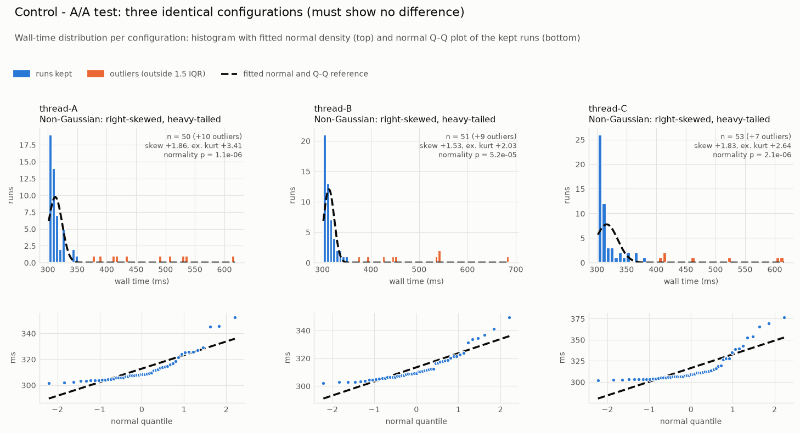

# Control - A/A test: three identical configurations (must show no difference): distribution shapes

| configuration | n | outliers | skewness | excess kurtosis | normality p | shape |
|---|---|---|---|---|---|---|
| thread-A | 60 | 10 | +1.86 | +3.41 | 1.12e-06 | Non-Gaussian: right-skewed, heavy-tailed |
| thread-B | 60 | 9 | +1.53 | +2.03 | 5.24e-05 | Non-Gaussian: right-skewed, heavy-tailed |
| thread-C | 60 | 7 | +1.83 | +2.64 | 2.10e-06 | Non-Gaussian: right-skewed, heavy-tailed |
