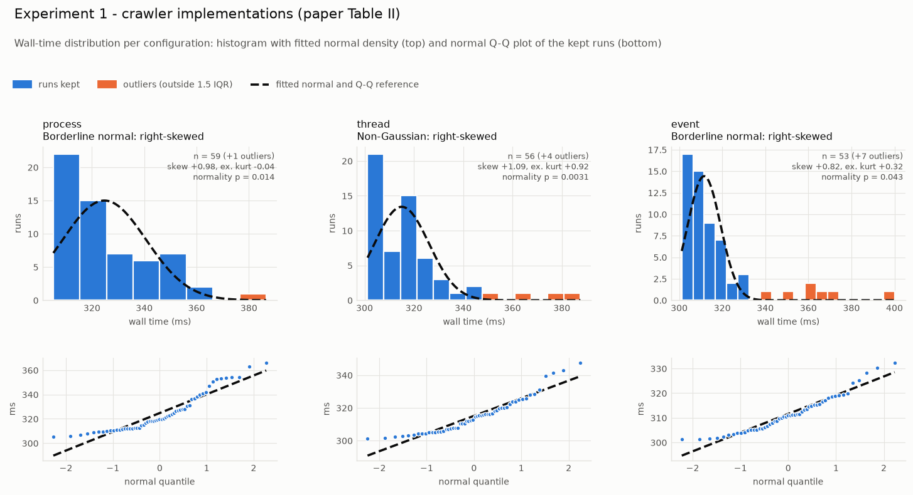

# Experiment 1 - crawler implementations (paper Table II): distribution shapes

| configuration | n | outliers | skewness | excess kurtosis | normality p | shape |
|---|---|---|---|---|---|---|
| process | 60 | 1 | +0.98 | -0.04 | 0.014 | Borderline normal: right-skewed |
| thread | 60 | 4 | +1.09 | +0.92 | 0.003 | Non-Gaussian: right-skewed |
| event | 60 | 7 | +0.82 | +0.32 | 0.043 | Borderline normal: right-skewed |
