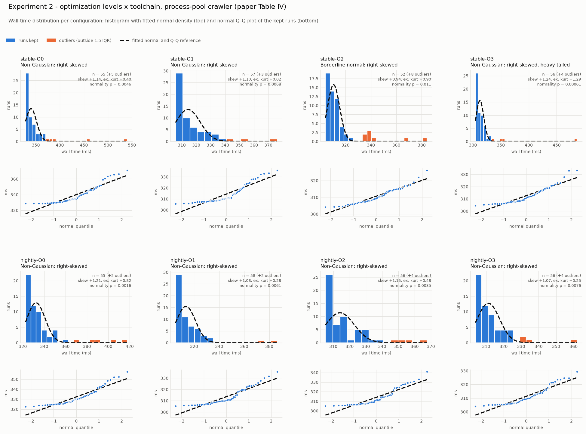

# Experiment 2 - optimization levels x toolchain, process-pool crawler (paper Table IV): distribution shapes

| configuration | n | outliers | skewness | excess kurtosis | normality p | shape |
|---|---|---|---|---|---|---|
| stable-O0 | 60 | 5 | +1.14 | +0.40 | 0.005 | Non-Gaussian: right-skewed |
| stable-O1 | 60 | 3 | +1.10 | +0.02 | 0.007 | Non-Gaussian: right-skewed |
| stable-O2 | 60 | 8 | +0.94 | +0.90 | 0.011 | Borderline normal: right-skewed |
| stable-O3 | 60 | 4 | +1.24 | +1.29 | 6.14e-04 | Non-Gaussian: right-skewed, heavy-tailed |
| nightly-O0 | 60 | 5 | +1.21 | +0.82 | 0.002 | Non-Gaussian: right-skewed |
| nightly-O1 | 60 | 2 | +1.08 | +0.28 | 0.006 | Non-Gaussian: right-skewed |
| nightly-O2 | 60 | 4 | +1.15 | +0.48 | 0.004 | Non-Gaussian: right-skewed |
| nightly-O3 | 60 | 4 | +1.07 | +0.25 | 0.008 | Non-Gaussian: right-skewed |
