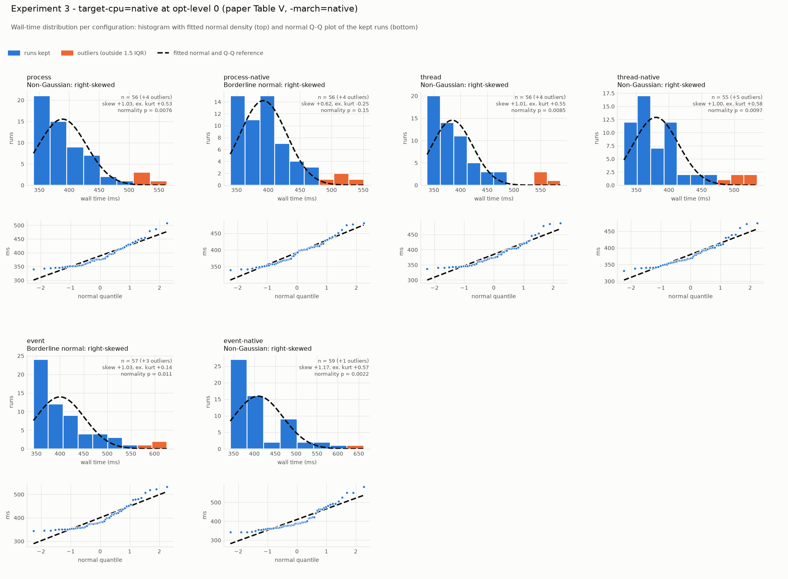

# Experiment 3 - target-cpu=native at opt-level 0 (paper Table V, -march=native): distribution shapes

| configuration | n | outliers | skewness | excess kurtosis | normality p | shape |
|---|---|---|---|---|---|---|
| process | 60 | 4 | +1.03 | +0.53 | 0.008 | Non-Gaussian: right-skewed |
| process-native | 60 | 4 | +0.62 | -0.25 | 0.150 | Borderline normal: right-skewed |
| thread | 60 | 4 | +1.01 | +0.55 | 0.008 | Non-Gaussian: right-skewed |
| thread-native | 60 | 5 | +1.00 | +0.58 | 0.010 | Non-Gaussian: right-skewed |
| event | 60 | 3 | +1.03 | +0.14 | 0.011 | Borderline normal: right-skewed |
| event-native | 60 | 1 | +1.17 | +0.57 | 0.002 | Non-Gaussian: right-skewed |
